# MTG Collection Manager

One app for your Magic: The Gathering finances: track what your collection is
worth over time **and** get a Discord alert when a card you want drops to your
price.

- **HAVE** – your collection, valued daily with Scryfall prices
- **WANT** – your wishlist, watched against Cardmarket prices

> "Your collection is worth €850, your wishlist still costs €120."

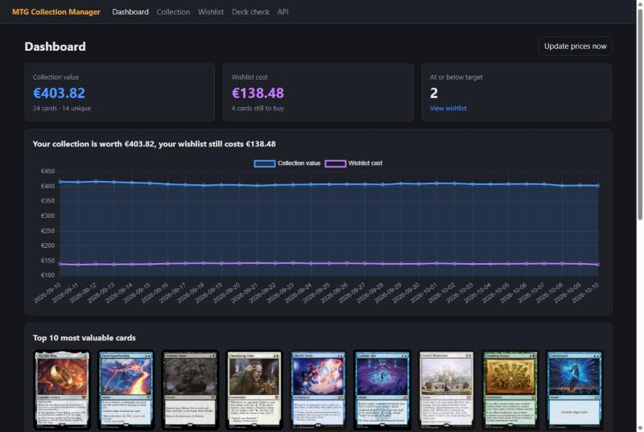

| Top cards and weekly movers | Wishlist with targets, sorted by current price |
| --- | --- |
| 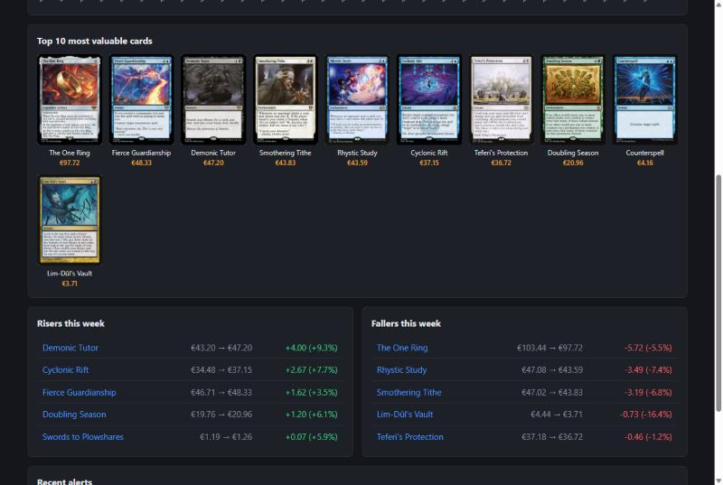 | 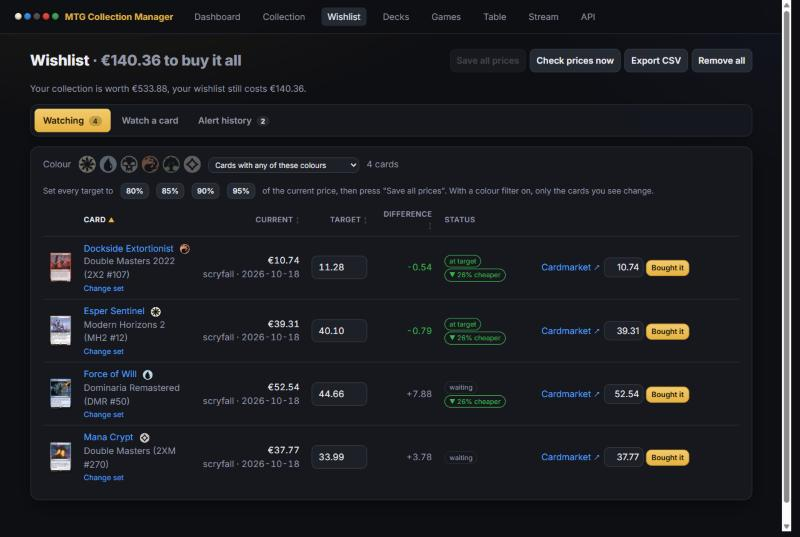 |

| Collection: add by name or card number, edit quantities | Saved decks, and the randomizer picking a deck for three players |
| --- | --- |
| 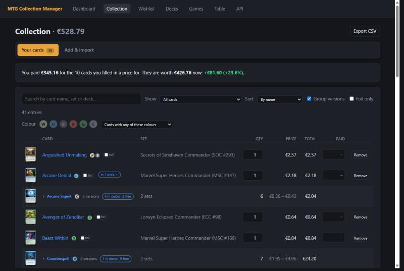 | 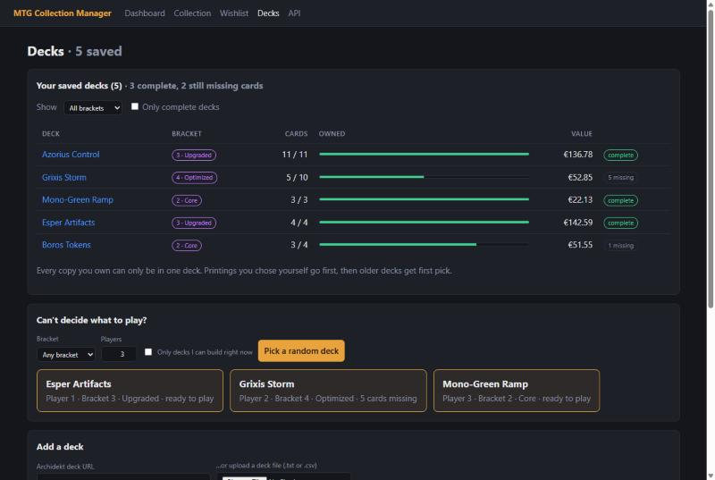 |

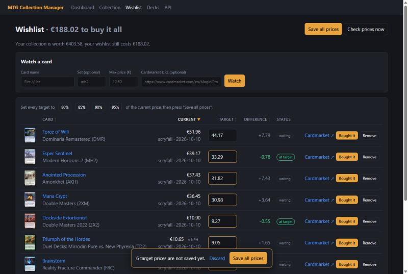

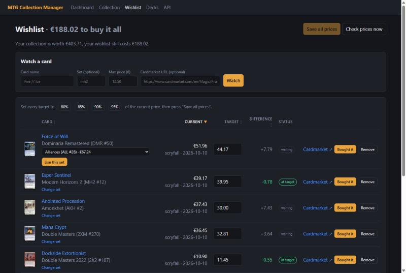

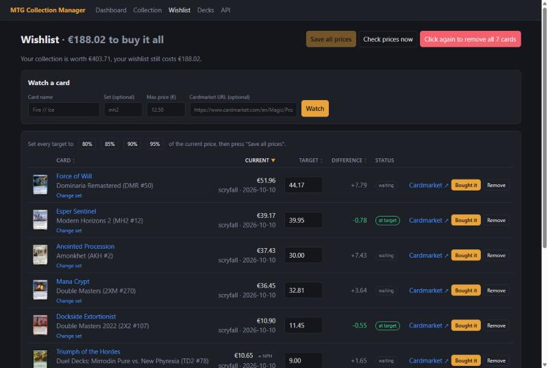

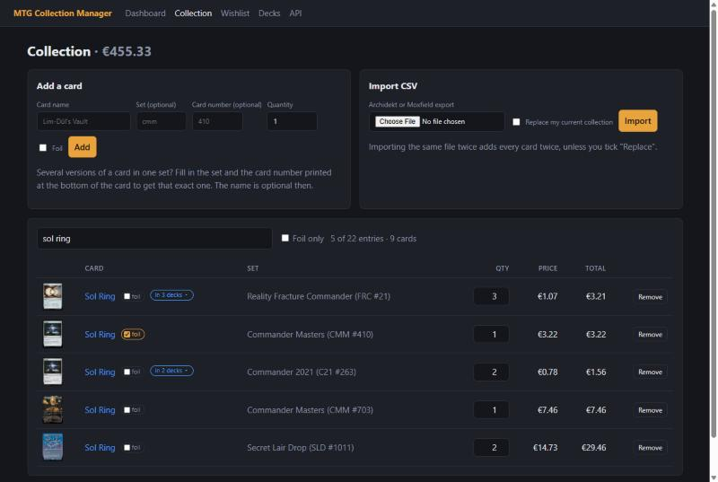

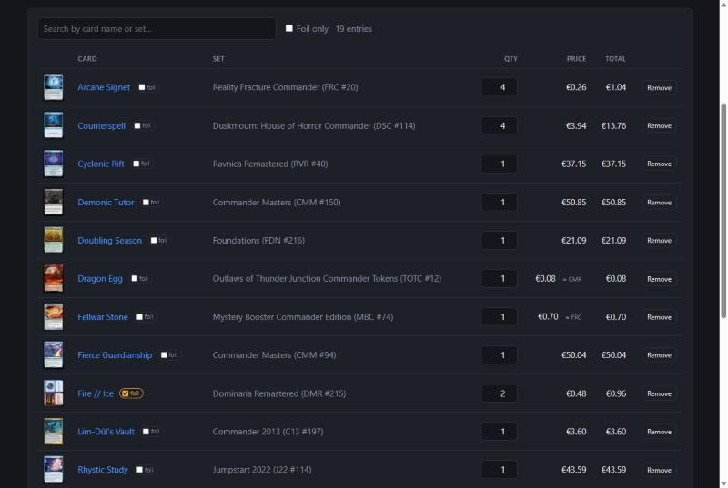

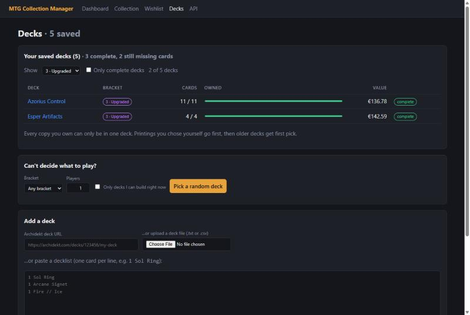

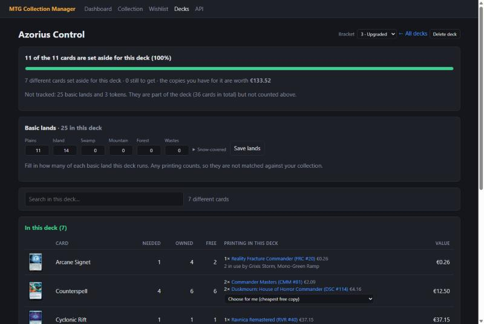

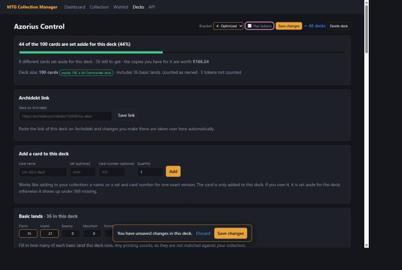

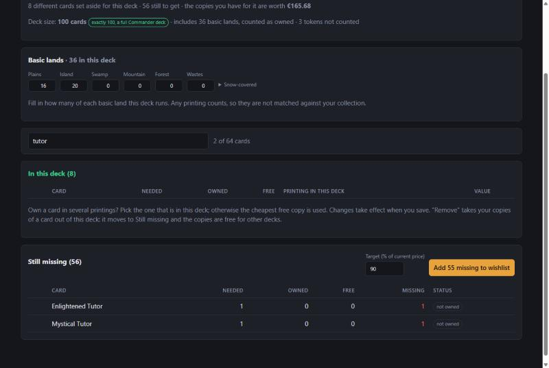

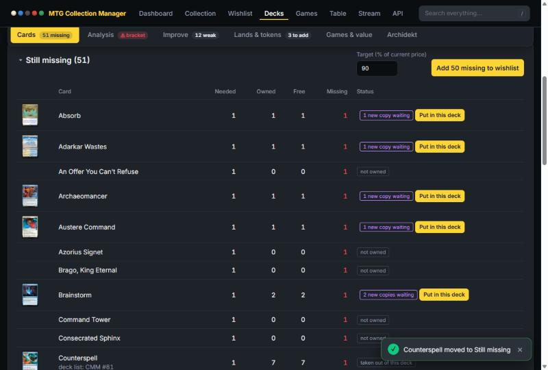

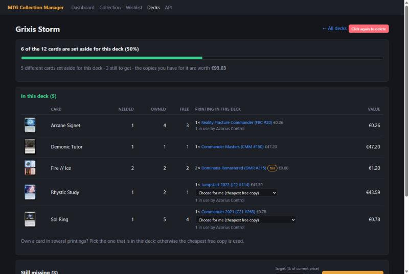

<sub>Destructive buttons use a two-click confirmation: the first click turns the button red ("Click again to delete"), a second click within four seconds confirms.</sub>

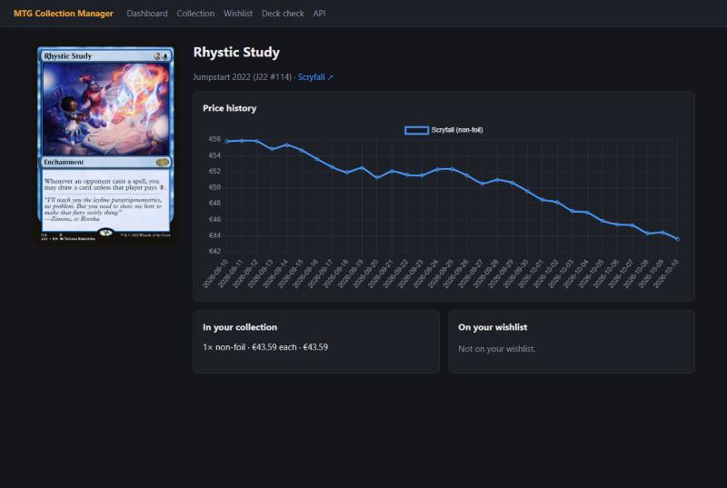

<sub>Screenshots use demo data: real cards and current prices, with a generated price history.</sub>

## Features

**Collection (HAVE)**
- Add cards by name (optionally a specific set, foil or non-foil), or by set + collector number to get one exact version when a set has several
- CSV import with automatic format detection (Archidekt, Moxfield, or any CSV with a quantity and name column); adds to your collection or replaces it
- Change the quantity of a card in place, without removing and re-adding it
- Instant search in the collection on card name or set (accents and word order do not matter), with a foil-only filter
- A printing without a price borrows the price of the cheapest printing with the same name, marked "≈ SET"
- Daily price snapshots, total value over time, top 10 most valuable cards, weekly risers and fallers
- Price history chart per card

**Wishlist (WANT)**
- Watch cards with a maximum price
- Periodic price check against Cardmarket, with Scryfall as a fallback
- Discord webhook alert when a price is at or below your target, at most once per card per 24 hours
- Choose the set you want a card from: "Change set" lists every printing with its price; the target price is kept
- Sort the wishlist by card name, current price, target price or difference, in either direction
- "Remove all" empties the wishlist in one go, after a second click to confirm
- Edit target prices freely and store them with one "Save all prices" button; set every target to 80, 85, 90 or 95% of the current price in one click
- Alert history

**Both**
- Collection value next to wishlist cost
- "Bought it" moves a card from WANT to HAVE
- Deck check: paste a decklist, upload a deck file or give an Archidekt URL. You see which cards you already own and in which printing (set, foil, quantity), so you can pull them from your collection, and you can add the missing cards to your wishlist in one click
- Saved decks: save a deck and the cards you own are set aside for it. Every copy can only be in one deck, so a second deck does not count the same Sol Ring again; it shows which deck is using it instead
- Basic lands and tokens are left out of the tracked cards by default, so they do not show up as missing or end up on your wishlist; tick a box to include them
- Basic lands per deck: fill in how many of each basic land a deck runs, whatever the printing. Imported decks start with the numbers from the list, and older decks can move their lands over in one click
- Deck randomizer: can't decide what to play? Pick a random deck, or a different one for every player at the table, optionally only from one bracket or only decks you can build right now
- Take a card out of a deck: "Remove" moves it from "In this deck" to "Still missing" and frees your copies for other decks; "Put back" undoes it
- Search inside a deck on card name or set
- One "Save changes" button per deck: bracket, basic lands and chosen printings are edited freely and stored together, with a reminder while there are unsaved changes
- Commander bracket per deck: taken from Archidekt when the deck has one, and changeable at any time
- Filter the list of saved decks by bracket, or show only the decks that are complete
- Choose the printing: if you own a card in several printings you pick which one is in the deck (say, the foil); otherwise the cheapest free copy is used
- Deck value: every saved deck shows what the copies in it are worth

## Quick start

```bash
python -m venv .venv
.venv\Scripts\activate          # Windows; use `source .venv/bin/activate` elsewhere
pip install -r requirements.txt
copy .env.example .env          # optional: set DISCORD_WEBHOOK_URL
uvicorn app.main:app --reload
```

Open <http://localhost:8000> for the dashboard and <http://localhost:8000/docs>
for the interactive API docs.

Run the tests (no network needed, every external service is mocked):

```bash
pytest
```

## Configuration

All settings are environment variables (see [.env.example](.env.example)).

| Variable | Default | Meaning |
| --- | --- | --- |
| `DATABASE_URL` | `sqlite:///./mtg.db` | SQLModel/SQLAlchemy database URL |
| `DISCORD_WEBHOOK_URL` | – | Where alerts are posted; without it alerts are only logged in the app |
| `SCHEDULER_ENABLED` | `true` | Run the background jobs |
| `DAILY_UPDATE_HOUR` | `6` | Hour of the daily Scryfall price update |
| `WISHLIST_CHECK_HOURS` | `6` | Interval of the wishlist check |
| `ALERT_COOLDOWN_HOURS` | `24` | Minimum time between two alerts for the same card |
| `SCRYFALL_MIN_INTERVAL` | `0.1` | Seconds between Scryfall requests (their limit is 10/s) |
| `SCRYFALL_SLOW_INTERVAL` | `0.6` | Seconds between Scryfall name lookups and bulk requests, which have a much lower limit |
| `CARDMARKET_MIN_INTERVAL` | `5` | Seconds between Cardmarket requests (plus random jitter) |
| `CARDMARKET_ENABLED` | `true` | Set to `false` to skip scraping and use Scryfall prices only |

## A note on Cardmarket

Cardmarket has no public API, so the scraper reads the "From" price off the
product page. Two things to know:

- **The HTML changes regularly.** All selectors and labels live in
  [app/cardmarket_selectors.json](app/cardmarket_selectors.json), so a layout
  change is a config edit instead of a code change.
- **Cardmarket sits behind bot protection** and at the time of writing answers
  plain HTTP clients with `403`. The app does not try to get around that. When
  a scrape fails, the wishlist check falls back to Scryfall's EUR price, which
  is Cardmarket's own price trend updated once a day. After three refusals
  in a row the scraper leaves Cardmarket alone for an hour, so a long wishlist
  is checked in seconds instead of waiting out the rate limit for every card.
  Every check first fetches today's Scryfall prices for the whole wishlist in
  bulk. Alerts therefore keep
  working; they just react to the trend price rather than the cheapest listing.
  The source of every price is shown in the wishlist.

## API

| Method | Path | |
| --- | --- | --- |
| `GET` / `POST` | `/api/collection` | List the collection (`?q=` searches name and set) / add a card and fetch its price |
| `POST` | `/api/collection/import` | Upload an Archidekt or Moxfield CSV |
| `PATCH` / `DELETE` | `/api/collection/{id}` | Change the quantity of an entry / remove it |
| `GET` / `POST` | `/api/wishlist` | List the wishlist / watch a card with a max price |
| `POST` | `/api/wishlist/{id}/purchase` | Move a card from WANT to HAVE |
| `PUT` | `/api/wishlist/targets` | Set several target prices at once |
| `PUT` | `/api/wishlist/{id}/printing` | Watch another printing (set) of the same card |
| `GET` | `/api/printings?name=` | Every printing of a card with its price |
| `DELETE` | `/api/wishlist/{id}` | Stop watching a card |
| `DELETE` | `/api/wishlist` | Stop watching every card |
| `GET` | `/api/alerts` | Alert history |
| `GET` | `/api/cards/{id}/prices` | Price history of one card |
| `GET` | `/api/summary` | Collection value vs. wishlist cost |
| `POST` | `/api/decks/check` | Have/missing overview for a decklist or Archidekt URL |
| `GET` / `POST` | `/api/decks` | List saved decks / save a deck and set its cards aside |
| `GET` | `/api/decks/random` | Pick random decks (`count`, `bracket`, `complete_only`) |
| `GET` / `DELETE` | `/api/decks/{id}` | A saved deck with its cards / delete it and free its cards |
| `PUT` | `/api/decks/{id}/cards/{entry_id}/printing` | Choose which printing a deck uses for a card |
| `PUT` | `/api/decks/{id}/cards/{entry_id}/assigned` | Take your copies of a card out of a deck, or put them back |
| `PUT` | `/api/decks/{id}/basic-lands` | Set how many of each basic land a deck runs |
| `PUT` | `/api/decks/{id}/bracket` | Set or clear the Commander bracket of a deck |
| `POST` | `/api/jobs/update-prices`, `/api/jobs/check-wishlist` | Run a background job now |

## How it works

```
app/
  main.py              FastAPI app, lifespan (database + scheduler)
  models.py            Card, CollectionEntry, WishlistEntry, PriceSnapshot, Alert, DailyTotal, Deck, DeckEntry, DeckPick, DeckBasicLand, DeckSkipped
  scryfall.py          async Scryfall client (httpx), batch lookups, 429 retry
  cardmarket.py        product page scraper (BeautifulSoup), selectors from JSON
  rate_limit.py        one independent rate-limit queue per external source
  csv_import.py        CSV parsing and format detection
  discord.py           webhook alerts
  jobs.py              APScheduler jobs: daily prices, periodic wishlist check
  services/            collection, wishlist, pricing snapshots, dashboard stats, deck check
  routers/             JSON API (api.py) and Jinja2 pages (pages.py)
  templates/, static/  dashboard UI with Chart.js
tests/                 pytest suite: Scryfall client, scraper, alert logic, CSV import, API
```

- **Snapshot pattern** – prices are stored once per card, per day, per source
  (`PriceSnapshot`), and the collection/wishlist totals once per day
  (`DailyTotal`). Charts and "movers" are computed from those.
- **Missing prices** – some printings have no price on Scryfall. Such a card
  borrows the price of the cheapest printing with the same name that does have
  one, marked with "≈ SET" so you can see it is not its own price. If no
  printing has a price (most tokens), the card shows "–" and counts as €0 in
  totals instead of breaking them.
- **Card names** – names like `Lim-Dûl's Vault` and `Fire // Ice` are covered
  by tests end to end (lookup, CSV import, deck check).

## Tech stack

FastAPI · SQLModel + SQLite · httpx · BeautifulSoup4 · APScheduler · Discord
webhooks · Jinja2 · Chart.js · pytest

Card data and prices by [Scryfall](https://scryfall.com). Not affiliated with
Wizards of the Coast, Scryfall, Cardmarket or Archidekt.
