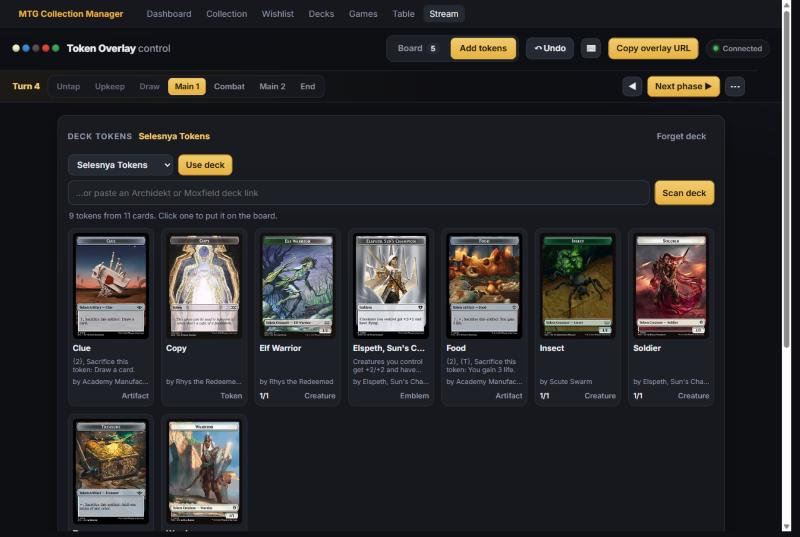
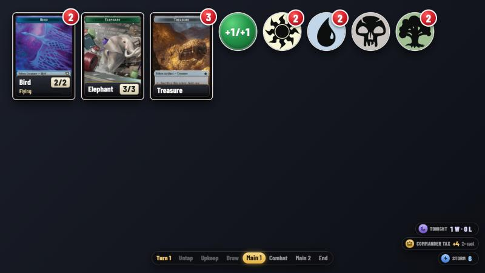
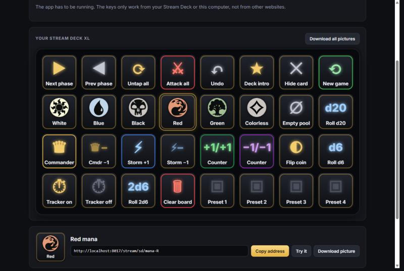

# Stream overlay for OBS

A small local web app for streaming Magic: type a token name ("Treasure",
"Goblin"), click it, and the card shows up in OBS right away. Change counts
with + and −, tap tokens, put +1/+1 or −1/−1 counters on them, split stacks,
and remove tokens with one click. No account and no extra software needed.

Part of the MTG Collection Manager: start the app as usual (see the [README](../README.md)) and
the overlay is there too. The control panel can take the tokens of any of your saved decks.

- Control panel: <http://localhost:8017/stream/control> (also **Stream** in the menu)
- Overlay for OBS: <http://localhost:8017/stream/overlay>





## How it works

```
 Control (/stream/control) ──REST──▶  FastAPI server  ──WebSocket──▶  Overlay (/stream/overlay)
        │                            stream-state.json                    in OBS
        └──── searches Scryfall directly (api.scryfall.com)
```

- One Python server on your own computer: `http://localhost:8017/stream`
- `/stream/control`: the control panel, in a browser tab or as an OBS dock
- `/stream/overlay`: the display, as a Browser Source in OBS
- The server keeps the tokens in `stream-state.json` and pushes every change over a
  WebSocket to all open pages
- Card data and images come from the free [Scryfall API](https://scryfall.com/docs/api)

## OBS setup

1. Start the MTG Collection Manager.
2. In OBS: **Sources > + > Browser**.
3. URL: `http://localhost:8017/stream/overlay`, width **1920**, height **1080**.
   The background is transparent, so only the tokens show up.
4. Control panel: open `http://localhost:8017/stream/control` in your browser, or add
   it in OBS via **Docks > Custom Browser Docks** so it sits next to your scene.

> **After an update:** restart the app. The overlay and control panel notice
> the server restarted and reload themselves. If something still looks off,
> right-click the Browser source in OBS > **Properties** > **Refresh cache of
> current page**.

### Overlay options

Via the URL, for example `http://localhost:8017/stream/overlay?size=200&pos=right`:

| Option | Values                                | Default |
|--------|---------------------------------------|---------|
| `size` | width per token in pixels (40–600)    | 150     |
| `pos`  | `left`, `center`, `right`             | left    |
| `row`  | `bottom` puts the row at the bottom    | top     |
| `outline` | `0` turns off the white card outline | on     |
| `phases` | turn tracker: `top`, `bottom` or `off`  | opposite the row |
| `tally` | commander tax & storm: `right`, `left` or `off` | right |
| `label` | `0` turns off the name & P/T plate     | on      |
| `preview` | `1` shows a checkered background (used by the control panel) | off |

> **Sharp cards:** give the Browser source the same width and height as your
> OBS canvas (e.g. 2560 × 1440 for a 1440p canvas) and don't resize it in OBS.
> Change the card size with `?size=` instead. Stretching or shrinking the
> source in OBS makes the cards blurry.

## The control panel

The control panel has two tabs:

- **Board**: what's on stream now, with the counters, mana pool and dice, and
  below it the layout settings with the live preview.
- **Add tokens**: your deck's tokens, search, and deck presets.

Each tab has its own address (`/stream/control#board`, `/stream/control#add`), so you can
also add two custom browser docks in OBS, side by side.

## Your saved decks

On **Add tokens**, pick one of the decks you saved in the collection manager and press **Use deck**:
every token its cards make shows up, ready to put on the board, with the cards that make it. On the
page of a deck, **◉ Stream tokens** does the same and opens the control panel. A link to a deck on
Archidekt or Moxfield still works too.

## Your deck's tokens (Archidekt / Moxfield)

On **Add tokens**, paste the link to your deck on Archidekt or Moxfield and
press **Scan deck**. The server reads the deck list (main deck, commanders and
companions; not the side- or maybeboard), asks Scryfall which tokens those
cards make, and shows them all as buttons: click one to put it on the board.
Each shows which of your cards makes it. The deck stays there after a restart
(saved in `stream-state-deck.json`); **Rescan** after you change the deck, **Forget
deck** to remove it. The deck has to be public.

## Placing cards anywhere (drag & drop)

The control panel has a **Layout** section with a live, scaled-down copy of
your overlay.

1. Set **Canvas** to your OBS canvas size and pick the **Card size**, row
   alignment and outline. These build the overlay URL shown under the preview
   (and copied by **Copy overlay URL**); use that URL and size for your OBS
   Browser source so the preview matches OBS exactly.
2. Drag a card stack in the preview to where you want it. OBS follows live.
3. **To row** (on a stack) or **Put all back in row** returns stacks to the
   default row.

- Stacks you never dragged stay in the default row (top-left, or at the
  bottom with **Row: bottom**).
- Positions are stored as a fraction of the screen, so they survive restarts
  and work at any resolution.
- Splitting a placed stack puts the new stack slightly to the right of it.
- You can also drag directly in OBS: right-click the Browser source >
  **Interact**.

## Loose counters (for cards on the table)

For counters you put on physical cards, add loose counters without a card:

- **+ +1/+1 counter** and **+ −1/−1 counter** (next to "On stream now") add
  one counter each click. The overlay shows a round chip (green / purple) with
  the number next to it.
- **+ Keyword counter…** adds keyword counters: Flying, First strike, Double
  strike, Deathtouch, Defender, Haste, Hexproof, Indestructible, Lifelink,
  Menace, Reach, Shroud, Trample, Vigilance and Ward. These show as pills.
- **Ward** needs a cost: a Ward counter gets a **Cost** field in the control
  panel. Type a number (`2` → **Ward 2**) or text (`Pay 3 life` →
  **Ward — Pay 3 life**). Ward piles with different costs stay separate.
  Tokens with Ward from Scryfall get their cost from the rules text
  automatically (e.g. "Ward {2}").
- Counter piles work like stacks: change the number, **Split…** them when the
  counters are on more than one card, drag them next to that card in your
  camera shot (Layout preview), **Merge** them back, or remove them.

## Turn tracker

Press **Start turn tracker** in the **Turn** block on the Board tab. The
overlay then shows a bar with the turn number and the phases (Untap, Upkeep,
Draw, Main 1, Combat, Main 2, End), the current one lit up.

- **Next phase ▶** (or **N**) goes to the next phase. The mana pool empties
  between phases, like the rules say.
- After **End**, the button says **Next turn ▶**: the turn number goes up,
  everything untaps, and the overlay shows "Turn 4" and "Untap step".
- Entering **Combat** shows a "⚔ Combat" banner.
- **◀** (or **Shift+N**) goes back a phase; click a phase to jump straight to it.
- **⋯** has **New game** (back to turn 1) and **Hide tracker**.
- **Undo** also takes back a phase step (including the mana it emptied).
- Where the bar sits: **Turn tracker** in the Layout settings (auto = opposite
  the row of cards, bottom, top or hidden), or `?phases=top|bottom|off`.

## Attack, copy, untap and undo

- **⚔ Attack** (on creature stacks) taps the stack and makes it lunge forward
  on stream with a red glow. Creatures with vigilance attack without tapping.
  **⚔ Attack with all** does that for every untapped creature, with an
  "Attack!" banner.
- **Copy one** and **Double (×2)** are in the **⋯** menu of a stack. Copies
  enter untapped and without counters, so they join a fresh stack (handy for
  Populate and token doublers).
- **Untap all** is your untap step: everything untaps with an "Untap step"
  banner and a little sparkle.
- **↶ Undo** (or **Ctrl+Z**) takes back the last change: a sacrifice, a tap,
  a cleared board, a loaded preset... up to 50 steps. Dragging things around
  isn't an undo step, and positions stay where they are when you undo.

## Show on stream: deck intro, commander tax & storm, spotlight

The **Show on stream** block on the Board tab:

- **Deck intro**: a bar slides in from the left with the commander art, "Now playing", the deck
  name, the commander, its bracket and your record with it from the game log (e.g. "4 W · 3 L").
  It shows by itself when you press **▶ Play** on a deck; **▶ Show deck intro** shows it again.
  For a deck from Archidekt or Moxfield it shows the deck name.
- **Commander tax & storm**: **♛ Cast commander** (or **K**) counts your commander casts; the
  overlay shows "Commander tax +4 · 2× cast". **⚡ Spell cast** (or **X**) counts the spells of this
  turn for storm and goes back to 0 every new turn. **−** (or **Shift+K** / **Shift+X**) takes one
  back. **New game** in the turn tracker resets both. The pills sit at the same height as the turn
  tracker, on the right (`?tally=left` or `?tally=off` in the overlay URL).
- **Spotlight**: type a card (the cards of your deck are suggested, in the printing you play; any
  other card comes from Scryfall) and press **★ Show**: it appears big in the middle of the stream
  for 5 to 15 seconds. **Hide** takes it away sooner.

## Deck presets

Put a deck's tokens on the board (with your layout), type a name under
**Deck presets** and press **Save board**. Later, **Load** puts that board back
in one click (everything untapped). Loading replaces the board; you can undo
it. Presets are saved in `stream-state-presets.json` next to `stream-state.json`.

## Keyboard shortcuts

Click a stack in the control panel to select it (or use ↑ ↓), then:
**T** tap/untap, **A** attack, **U** use (Treasure: pick a colour), **S**
sacrifice one, **+ / −** one more / less, **C** copy one, **D** double,
**Delete** remove. Anytime: **Shift+A** attack with all, **Shift+T** untap all,
**1–6** add W U B R G C mana, **0** empty the pool, **R** roll a d20,
**K** / **Shift+K** commander cast / one back, **X** / **Shift+X** a spell for storm / one back,
**N** / **Shift+N** next / previous phase, **Ctrl+Z** undo, **/** search,
**?** the list of shortcuts, **Esc** deselect.

### Stream Deck

The **Stream Deck** page (<http://localhost:8017/stream/streamdeck>, or **Stream Deck** at the top of
the control panel) has a ready-made layout for a Stream Deck XL (8 × 4 keys): turn, untap, attack,
undo, the deck intro, the six mana colours, commander tax, storm, counters, dice, the turn tracker
and your first four presets. Click a key for its address and its picture.



No plugin is needed:

1. In the Stream Deck software, drag **Website** (under **System**) onto a key.
2. Paste the key's address (**Copy address**), e.g. `http://localhost:8017/stream/sd/next-phase`.
3. Tick **GET request in background**, so no browser window opens.
4. **Download picture** and set it on the key (click the key picture > **Set from file**); leave the
   title empty, the name is on the picture. **Download all pictures** gets all 32 at once.

A preset has its own address: `http://localhost:8017/stream/sd/preset/<name>`. The `/stream/sd/...`
addresses only work from your Stream Deck or this app, not from other websites.

A plugin that can send other web requests (e.g. "API Ninja" or "Web Requests") can also use the
API directly:

| Button | Request |
|---|---|
| Next phase | `POST http://localhost:8017/stream/api/turn/next` |
| Untap step | `POST http://localhost:8017/stream/api/untap` |
| Attack with all | `POST http://localhost:8017/stream/api/attack-all` |
| Undo | `POST http://localhost:8017/stream/api/undo` |
| Roll a d20 | `POST http://localhost:8017/stream/api/roll` with `{"kind": "d20"}` |
| Add red mana | `POST http://localhost:8017/stream/api/counters` with `{"type": "R"}` |
| Empty mana pool | `POST http://localhost:8017/stream/api/mana/empty` |
| Load a preset | `POST http://localhost:8017/stream/api/presets/Krenko/load` |
| Cast commander | `POST http://localhost:8017/stream/api/tally/casts` |
| Spell for storm | `POST http://localhost:8017/stream/api/tally/storm` |
| Deck intro | `POST http://localhost:8017/stream/api/intro` |

## Mana pool

The **Mana pool** bar has a button per colour: **W U B R G C** (white, blue,
black, red, green, colorless). Each click adds one mana; the overlay shows the real
mana symbol (Scryfall's SVG; the letter if it can't be loaded), with a number
when you have more than one. **Use** on a Treasure or Gold asks which colour and puts that mana in
the pool; Powerstone adds {C}. Take mana off with − or ✕ per colour, or **Empty pool** to clear all
of it at once (mana empties at the end of each step). Mana piles can be dragged
like everything else.

## Dice, coins and sparks

- **Roll on stream** (in the control panel): Coin, d4, d6, 2d6, d8, d10, d12
  and d20. The server rolls (fair randomness, same result everywhere) and the
  dice roll in across the screen, bouncing and spinning, before they land in
  the middle. Each die has its real shape: d4 triangle, d6 square with pips,
  d8 diamond, d10 kite, d12 pentagon, d20 faceted hexagon, each in its own
  colour. The coin flies in flipping and shows HEADS or TAILS. A natural 20 glows gold with
  "NAT 20!" and a burst of gold; a natural 1 turns red. The result also pops up
  in the control panel. Rolls aren't stored.
- **Sacrifice** (on every token stack, plus **Sac all** for bigger stacks):
  a burst and **Sacrificed**. Sacrificing on its own gives you nothing (think
  edicts and sac outlets), so that's all it shows.
- **Use** activates the ability of tokens that have one, one token per click:

  | Token | Cost | On stream |
  |---|---|---|
  | Treasure | {T}, Sacrifice | taps, then **+1 mana** |
  | Gold | Sacrifice | **+1 mana** |
  | Food | {2}, {T}, Sacrifice | taps, then **+3 life** |
  | Clue | {2}, Sacrifice | **Draw a card** |
  | Blood | {1}, {T}, Discard a card, Sacrifice | taps, then **Rummage** |
  | Map | {1}, {T}, Sacrifice | taps, then **Explore** |
  | Powerstone | {T} | taps (stays on the board), **+1 colorless** |

  If the cost includes {T}, the token taps first and then bursts; **Use** is
  disabled while it's already tapped. When you use one token of a bigger
  stack, a copy of the card taps and bursts while the stack counts down.
  Hover the button to see the cost (mana costs like {2} you pay yourself).
- **Sparks:** when a token leaves the board, or one is taken off a stack
  (sacrificed, died), it bursts into sparks: gold coins for Treasure/Gold,
  the counter's colour for loose counters, embers for everything else.

## Searching tokens and cards

Use the **Tokens / Cards** switch above the search field:

- **Tokens** searches token cards (the default).
- **Cards** searches every real Magic card, so you can put a card you have
  physically on the table into the overlay and track +1/+1 or −1/−1 counters,
  tapping and its current power/toughness on stream. Autocomplete uses
  Scryfall's card-name suggestions.

Token search details:

- Start typing and an autocomplete list appears right away. It lists every
  **variant** of a token separately, with power/toughness, colour and
  abilities. Angel, for example, has several:
  - Angel · 4/4 · White · Flying
  - Angel · 4/4 · White · Flying, vigilance
  - Angel · 3/3 · Blue · Flying
  - …
- Pick one with the mouse, or with ↑/↓ and Enter (or Tab). You then only see
  the artworks of exactly that variant.
- Press Enter without picking a suggestion to search freely (Scryfall syntax
  works too, e.g. `goblin pow=1`).
- Every result shows its colour and abilities too, so you can tell
  variants apart there as well (hover for the full rules text).
- The variant list is fetched from Scryfall once and cached in your browser
  for a week.

## Stacks: splitting, tapping and counters

Every row in the control panel is a **stack** of identical tokens. Change the
number with − and +, or click the number and type it (Enter to apply, 0 removes it). Tapping and
counters apply to the whole stack. To tap or put a counter on only some of
them, split first:

1. Click **Split…** on a stack of 5 Goblins and choose, say, 2.
2. You now have a stack of 3 and a stack of 2 right next to it.
3. Tap the stack of 2 to attack, or give it a +1/+1 counter.

- Every card in the overlay has a **name plate** in plain text at the bottom:
  the token name and its current power/toughness, counters included (a 2/2
  with two +1/+1 counters shows a green **4/4**, purple for −1/−1). It stays
  sharp at any size and stays horizontal on tapped cards. Keyword abilities
  (Flying, Vigilance, Trample…) are listed under the name. Turn it off with
  **Name & P/T** in the Layout settings (or `?label=0`).
- **Tap** turns the card sideways in the overlay; **Untap all** is your untap step.
- **+1/+1** and **−1/−1** track a single number, because in MTG those
  counters cancel each other out. The overlay then shows the new
  power/toughness (a 1/1 with two counters gets a green **3/3** label, purple
  for −1/−1). If the card has no fixed power/toughness (like `*/*`), it shows
  **+2/+2**.
- **\*/\* tokens:** stacks printed with a `*` get two small fields in the
  control panel to set power and toughness by hand. Counters add on top, and
  the printed value is kept, so you can change or clear it any time.
- **Merge** appears as soon as there's another stack that looks exactly the
  same (same card, same tapped state, same counters).
- Adding a new token only joins an untapped stack without counters; otherwise
  it starts a new stack.
- At most 30 stacks at once.

Two different versions of a token (different artwork) are always separate stacks.

## API

Handy for hotkeys or a Stream Deck.

| Method | Path                     | Body                                  | What |
|--------|--------------------------|---------------------------------------|------|
| GET    | `/stream/api/version`           |                                       | whether the running server is older than the code on disk |
| GET    | `/stream/api/state`             |                                       | current state |
| POST   | `/stream/api/tokens`            | `{"name": "...", "image_url": "..."}` | add, or +1 if it's already there |
| PATCH  | `/stream/api/tokens/{id}`       | `{"delta": 1}` or `{"delta": -1}`     | change count; removed at 0 |
| PATCH  | `/stream/api/tokens/{id}`       | `{"count": 5}`                        | set the count directly; 0 removes it |
| PATCH  | `/stream/api/tokens/{id}`       | `{"tapped": true}` / `false`          | tap or untap |
| PATCH  | `/stream/api/tokens/{id}`       | `{"counter_delta": 1}` or `-1`        | add a +1/+1 or −1/−1 counter |
| POST   | `/stream/api/tokens/{id}/split` | `{"count": 2}`                        | move that many to a new stack next to it |
| POST   | `/stream/api/tokens/{id}/sacrifice` | `{"count": 1}`                    | sacrifice tokens from a stack (with the effect on stream) |
| POST   | `/stream/api/tokens/{id}/use`   | `{"color": "R"}` (Treasure/Gold)      | use the ability of one token (Treasure, Food, Clue, ...); mana goes into the pool |
| POST   | `/stream/api/tokens/{id}/attack` |                                      | a creature stack attacks (taps unless it has vigilance) |
| POST   | `/stream/api/attack-all`        |                                       | every untapped creature attacks |
| POST   | `/stream/api/tokens/{id}/copy`  | `{"count": 1}`                        | create copies (untapped, no counters) |
| POST   | `/stream/api/undo`              |                                       | undo the last change |
| GET    | `/stream/api/deck`              |                                       | the scanned deck and its tokens (or `null`) |
| POST   | `/stream/api/deck`              | `{"url": "https://moxfield.com/decks/..."}` | scan an Archidekt/Moxfield deck for its tokens |
| DELETE | `/stream/api/deck`              |                                       | forget the scanned deck |
| GET    | `/stream/api/presets`           |                                       | saved presets |
| POST   | `/stream/api/presets`           | `{"name": "Krenko"}`                  | save the current board as a preset |
| POST   | `/stream/api/presets/{name}/load` |                                     | replace the board with a preset |
| DELETE | `/stream/api/presets/{name}`    |                                       | delete a preset |
| GET    | `/stream/api/abilities`         |                                       | the tokens that have a Use ability, with cost and effect |
| POST   | `/stream/api/tokens/{id}/merge` |                                       | merge identical stacks into this one |
| PATCH  | `/stream/api/tokens/{id}`       | `{"pos": {"x": 0.5, "y": 0.2}}` / `{"pos": null}` | place a stack (fractions of the screen, top-left corner) / back to the row |
| POST   | `/stream/api/positions/reset`   |                                       | put every stack back in the row |
| GET    | `/stream/api/counter-types`     |                                       | the loose counter types (P/T and keywords) |
| POST   | `/stream/api/counters`          | `{"type": "+1/+1"}` / `{"type": "Ward", "value": "2"}` / `{"type": "R"}` | add one loose counter or mana (W U B R G C); `value` is optional |
| POST   | `/stream/api/roll`              | `{"kind": "d20"}` / `{"kind": "d6", "count": 2}` / `{"kind": "coin"}` | roll on stream (1–6 dice); returns the result |
| POST   | `/stream/api/mana/empty`        |                                       | remove all mana from the pool |
| POST   | `/stream/api/turn/next`         |                                       | next phase (mana empties; after End a new turn, everything untaps) |
| POST   | `/stream/api/turn/prev`         |                                       | previous phase |
| PATCH  | `/stream/api/turn`              | `{"on": true}` / `{"phase": "combat"}` / `{"number": 1}` / `{"casts": 0, "storm": 0}` | show/hide the tracker, jump to a phase, set the turn or the tallies |
| POST   | `/stream/api/untap`             |                                       | untap everything |
| POST   | `/stream/api/tally/casts`       | none, or `{"delta": -1}`              | one commander cast more (or back); the tax is 2 per cast |
| POST   | `/stream/api/tally/storm`       | none, or `{"delta": -1}`              | one spell more for storm (or back); 0 again every new turn |
| POST   | `/stream/api/spotlight`         | `{"name": "...", "image_url": "...", "seconds": 7}` | show a card big on stream (2–30 seconds) |
| DELETE | `/stream/api/spotlight`         |                                       | take the spotlight card away |
| POST   | `/stream/api/intro`             | none, or `{"name": "...", "commander": "...", "bracket": "...", "record": "..."}` | show the deck intro (of the deck in the control panel) |
| DELETE | `/stream/api/tokens/{id}`       |                                       | remove |
| POST   | `/stream/api/clear`             |                                       | clear everything |
| GET    | `/stream/sd/{action}`           |                                       | Stream Deck: press a key (`next-phase`, `mana-R`, `storm`, ...; see `/stream/api/streamdeck`) |
| GET    | `/stream/sd/preset/{name}`      |                                       | Stream Deck: load a preset |
| GET    | `/stream/api/streamdeck`        |                                       | the Stream Deck keys in order, and your presets |
| WS     | `/stream/ws`                    |                                       | state on connect and after every change; dice rolls, sacrifices, uses, attacks, the untap step, tallies, the spotlight and the deck intro arrive as `{"event": {...}}` |

`POST /api/tokens` also accepts optional `power`, `toughness` and `keywords`
(a list of strings). PATCH also takes `set_power` / `set_toughness` (numbers,
or `null` to clear) for manual power/toughness, and `value` (text, `null` or
`""` to clear) for a loose counter such as the Ward cost. Fields in a
single PATCH can be combined, e.g. `{"tapped": true, "counter_delta": 1}`.

## Security

- The server only listens on `127.0.0.1`, so nobody else on your network can reach it.
- Images must come from `https://cards.scryfall.io/`; other URLs are rejected
  (422). That way no random image can ever end up on your stream.
- At most 30 stacks and 999 tokens per stack.
- Both pages build everything with DOM methods and `textContent`, never `innerHTML`.
- `stream-state.json` is written to a temporary file first and then renamed, so it's
  never half-written. A broken file gives an empty list instead of a crash.

## Files

```
app/stream/server.py          server: TokenStore, Hub (WebSockets), routes
app/stream/static/control.html  control panel with Scryfall search
app/stream/static/overlay.html  display for OBS
app/services/stream_link.py   a saved deck's tokens for the control panel
tests/test_stream.py          tests
stream-state.json             the board (created automatically)
stream-state-presets.json     your deck presets
stream-state-deck.json        the deck and its tokens
```
